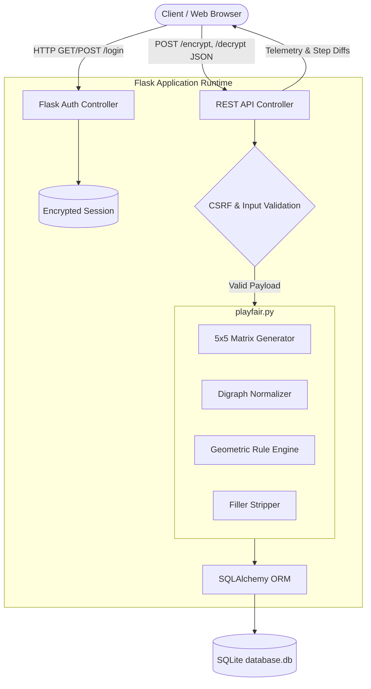
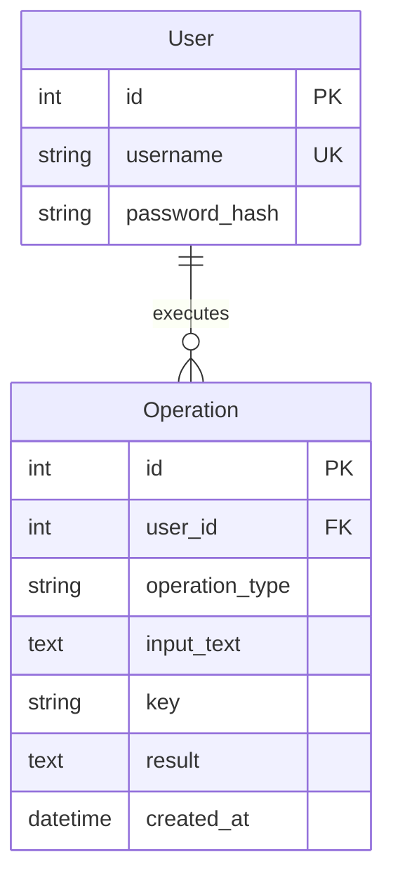

# Playfair Cipher Dashboard & Cryptographic Visualizer

[](https://www.python.org/)
[](https://flask.palletsprojects.com/)
[](https://www.sqlite.org/)
[](https://getbootstrap.com/)
[](https://www.chartjs.org/)
[](README.md#offline-readiness)

An interactive, full-stack cryptographic web dashboard engineered for computer science education, academic demonstrations, and visual cryptanalysis of the **Playfair Digraph Substitution Cipher** (invented by Charles Wheatstone in 1854 and popularized by Lord Playfair).

> **Educational Notice:** The Playfair cipher is a classical symmetric polygraphic substitution cipher. It is presented here strictly for educational, historical, and pedagogical purposes. It does not provide cryptographic security for modern communication.

---

## Table of Contents
1. [Overview & Architecture](#overview--architecture)
2. [Core Features](#core-features)
3. [Formal Cryptographic Specification](#formal-cryptographic-specification)
   - [Alphabet & 5x5 Key Matrix Generation](#1-alphabet--5x5-key-matrix-generation)
   - [Plaintext Normalization & Digraph Formation](#2-plaintext-normalization--digraph-formation)
   - [Mathematical Transformation Rules](#3-mathematical-transformation-rules)
   - [Decryption & Post-Processing](#4-decryption--post-processing)
   - [Trace Example](#5-fully-worked-trace-example)
4. [Cryptanalysis & Academic Context (Viva Ready)](#cryptanalysis--academic-context-viva-ready)
5. [System Architecture & Data Flow](#system-architecture--data-flow)
6. [Database Schema](#database-schema)
7. [REST API Specification](#rest-api-specification)
8. [Security & Hardening](#security--hardening)
9. [Project Directory Layout](#project-directory-layout)
10. [Installation & Setup](#installation--setup)
11. [Default Credentials](#default-credentials)

---

## Overview & Architecture

The application implements a decoupled, full-stack architecture where the cryptographic transformation engine is completely isolated from HTTP transport and presentation layers:

- **Core Cryptographic Engine (`playfair.py`)**: A pure Python module executing key matrix synthesis, digraph partitioning, coordinate transformation, and step telemetry without external dependencies.
- **Application Controller (`app.py`)**: A Flask web service providing session-based authentication, CSRF validation, parameter sanitization, and RESTful execution endpoints.
- **Persistence Layer (`database.db`)**: SQLAlchemy-managed SQLite storage logging operations, execution metrics, and user credentials.
- **Presentation & Visualizer (`static/` + `templates/`)**: Dynamic glassmorphism dark-mode UI with live interactive matrix highlighting, automated playback controls, and Chart.js telemetry.



---

## Core Features

### 1. Live 5 × 5 Key Matrix Synthesis
- Rebuilds dynamically as the user types the secret key.
- Automatically handles deduplication and maps letter `J` to `I`.
- Fills remaining cells with the unused alphabet characters ($A \dots Z \setminus \{J\}$).

### 2. Interactive Digraph Normalization Inspector
- Displays sanitized uppercase characters.
- Visual badges denote converted letters (`J` $\to$ `I`) and injected filler characters (`X` or alternate `Q`).
- Automatically handles odd-length terminal padding.

### 3. Step-by-Step Rule Visualizer & Playback
- Detailed tabular breakdown for every digraph:
  - Input pair and 0-indexed matrix coordinates `(row, col)`.
  - Geometric rule triggered (**Row**, **Column**, or **Rectangle**).
  - Explicit explanation of shift or swap arithmetic.
  - Resulting ciphertext/plaintext pair and new coordinates.
- **Matrix Animation:** Click any step or use the **Play / Pause** animation controller to visually highlight input cells and transformed output cells directly on the 5×5 grid.

### 4. Intelligent Probable Plaintext Recovery
- Upon decryption, the engine applies contextual heuristics to identify and strip padding letters (e.g., removing `X` inserted between identical characters like `BAL XL OON` $\to$ `BALLOON` and trailing odd-length padding).

### 5. Telemetry, Analytics & Audit History
- Live dashboard metrics: Total Operations, Encrypted vs. Decrypted Counts, Average Key Length.
- Historical operations log with multi-field search (`message`, `key`, `result`) and filter capabilities.
- 7-day visual throughput timeline powered by Chart.js.
- One-click copy and text file export (`playfair_result.txt`).

### 6. 100% Offline Viva Ready
- All vendor assets (Bootstrap 5.3, Font Awesome 6.x, Chart.js, JetBrains Mono, and Space Grotesk fonts) are bundled locally in `static/vendor/`. No internet connection is required during live viva evaluations or lab exams.

---

## Formal Cryptographic Specification

### 1. Alphabet & 5x5 Key Matrix Generation
The cipher space uses a 25-letter alphabet $\Sigma$:
$$\Sigma = \{A, B, C, D, E, F, G, H, I, K, L, M, N, O, P, Q, R, S, T, U, V, W, X, Y, Z\}$$
Where character `J` is merged into cell `I` ($J \equiv I$).

Given a keyword string $K$:
1. Normalize $K$: uppercase, retain $[A-Z]$, substitute $J \mapsto I$.
2. Extract the unique ordered set of characters $K_{uniq}$.
3. Append the remaining characters of $\Sigma \setminus K_{uniq}$ in alphabetical order.
4. Reshape the resulting 25-element sequence into a $5 \times 5$ matrix $M \in \Sigma^{5 \times 5}$.

Each character $c \in \Sigma$ has a unique coordinate mapping $\phi(c) = (r, c)$ where $r, c \in \{0, 1, 2, 3, 4\}$.

### 2. Plaintext Normalization & Digraph Formation
Given an input text $P$:
1. Filter $P \to P' \in \Sigma^*$ by stripping non-alphabetic characters and mapping $J \mapsto I$.
2. Iterate through $P'$ to construct letter pairs $(p_1, p_2)$:
   - If $p_1 = p_2$, inject filler character $f$ where:
     $$f = \begin{cases} Q & \text{if } p_1 = X \\ X & \text{otherwise} \end{cases}$$
     Emit pair $(p_1, f)$ and process $p_2$ in the subsequent cycle.
   - If $p_1 \neq p_2$, emit $(p_1, p_2)$ and advance 2 characters.
   - If a single terminal character $p_{last}$ remains, pad with filler $f$: emit $(p_{last}, f)$.

### 3. Mathematical Transformation Rules
Let a digraph pair be $(A, B)$ with matrix coordinates $\phi(A) = (r_a, c_a)$ and $\phi(B) = (r_b, c_b)$.

Let shift direction $\delta$:
$$\delta = \begin{cases} +1 & \text{for Encryption} \\ -1 & \text{for Decryption} \end{cases}$$

#### Rule 1: Same Row ($r_a = r_b$)
Both characters shift horizontally with wrap-around (modulo 5):
$$\phi(A') = (r_a, (c_a + \delta) \pmod 5)$$
$$\phi(B') = (r_b, (c_b + \delta) \pmod 5)$$

#### Rule 2: Same Column ($c_a = c_b$)
Both characters shift vertically with wrap-around (modulo 5):
$$\phi(A') = ((r_a + \delta) \pmod 5, c_a)$$
$$\phi(B') = ((r_b + \delta) \pmod 5, c_b)$$

#### Rule 3: Rectangle / Intersection ($r_a \neq r_b$ and $c_a \neq c_b$)
Each character assumes the column coordinate of the opposite character while retaining its own row:
$$\phi(A') = (r_a, c_b)$$
$$\phi(B') = (r_b, c_a)$$
*(Note: The rectangle rule is symmetric between encryption and decryption).*

### 4. Decryption & Post-Processing
Applying the inverse shifts ($\delta = -1$) restores the normalized digraphs. The engine's post-processor analyzes adjacent characters to reconstruct probable plaintext:
- Detects patterns $c_1 X c_2$ where $c_1 = c_2$ and removes the intermediate $X$ ($Q$).
- Discards terminal padding $X$ ($Q$) if added during normalization.

---

### 5. Fully Worked Trace Example

**Secret Key:** `MONARCHY`  
**Plaintext:** `INSTRUMENTS`

#### Generated Matrix $M$:
```text
Row 0:   M   O   N   A   R
Row 1:   C   H   Y   B   D
Row 2:   E   F   G   I   K
Row 3:   L   P   Q   S   T
Row 4:   U   V   W   X   Z
```

#### Step Trace:
| Step | Digraph | Coord A | Coord B | Geometric Case | Transformed Output | Explanation |
|:---:|:---:|:---:|:---:|:---:|:---:|:---|
| 1 | **IN** | (2, 3) | (0, 2) | Rectangle | **GA** | Swap columns: $I(2,3) \to G(2,2)$, $N(0,2) \to A(0,3)$ |
| 2 | **ST** | (3, 3) | (3, 4) | Same Row | **TL** | Shift right: $S(3,3) \to T(3,4)$, $T(3,4) \to L(3,0)$ (wrap) |
| 3 | **RU** | (0, 4) | (4, 0) | Rectangle | **MZ** | Swap columns: $R(0,4) \to M(0,0)$, $U(4,0) \to Z(4,4)$ |
| 4 | **ME** | (0, 0) | (2, 0) | Same Col | **CL** | Shift down: $M(0,0) \to C(1,0)$, $E(2,0) \to L(3,0)$ |
| 5 | **NT** | (0, 2) | (3, 4) | Rectangle | **RQ** | Swap columns: $N(0,2) \to R(0,4)$, $T(3,4) \to Q(3,2)$ |
| 6 | **SX** | (3, 3) | (4, 3) | Same Col | **XA** | Shift down: $S(3,3) \to X(4,3)$, $X(4,3) \to A(0,3)$ (wrap) |

**Final Ciphertext:** `GA TL MZ CL RQ XA`

---

## Cryptanalysis & Academic Context (Viva Ready)

| Metric | Monographic Substitution (Caesar) | Polygraphic Substitution (Playfair) | Modern Symmetric (AES-128) |
|---|---|---|---|
| **Cipher Unit** | 1 Letter (Monograph) | 2 Letters (Digraph) | 128-bit Block |
| **Keyspace / Permutations** | 26 possible shifts | $25! \approx 1.55 \times 10^{25}$ matrices | $2^{128} \approx 3.4 \times 10^{38}$ |
| **Frequency Analysis Resistance** | None (trivial single-letter frequencies) | Moderate (flattens letter distribution across $25 \times 24 = 600$ pairs) | Immune to classical statistical analysis |
| **Invariance Weakness** | $c = (p + k) \bmod 26$ | Pair symmetry: $AB \to CD \iff BA \to DC$ | Complete diffusion (Avalanche Effect) |
| **Self-Encryption** | $p = c$ possible when $k = 0$ | **Impossible**: a letter never encrypts to itself | Probabilistic |

### Academic Discussion Points:
1. **Digraph Flattening:** By operating on pairs, single-letter frequency spikes (e.g., `E`, `T`, `A`) are dispersed across up to 25 distinct combinations.
2. **Structural Vulnerabilities:**
   - **No Self-Substitution:** A character cannot map to itself in any valid Playfair transformation, leaking negative information to cryptanalysts.
   - **Reversibility / Symmetry:** In rectangle transformations, reversing the input pair reverses the output pair ($AB \to XY \implies BA \to YX$).
   - **Known-Plaintext Sensitivity:** With approximately 30 known corresponding digraphs, the complete $5 \times 5$ matrix can be reconstructed using graph theoretical methods.

---

## System Architecture & Data Flow

```text
playfair_cipher_dashboard/
├── app.py                      # Flask Application Controller & REST API
├── playfair.py                 # Pure Cryptographic Transformation Engine
├── requirements.txt            # Python Dependencies (Flask, SQLAlchemy, Werkzeug)
├── database.db                 # SQLite Relational Database (Generated)
├── templates/                  # Jinja2 HTML Templates
│   ├── base.html               # Master Layout, Glassmorphism Shell & Navigation
│   ├── index.html              # Landing Page & Feature Overview
│   ├── login.html              # Secure Authentication Portal
│   ├── dashboard.html          # Interactive Live Cipher Workbench & Visualizer
│   ├── history.html            # Searchable Audit Log & Record Management
│   ├── how_it_works.html       # Mathematical Theory, Diagrams & Worked Example
│   └── error.html              # Custom HTTP Error Boundary (400, 404, 413, 500)
├── static/
│   ├── css/style.css           # Glassmorphism Theme & Custom Styling
│   ├── js/script.js            # Frontend Controller (Fetch API, DOM & Visualizer)
│   └── vendor/                 # 100% Bundled Offline Libraries & Fonts
│       ├── bootstrap/          # Bootstrap 5.3 Framework
│       ├── fontawesome/        # Font Awesome 6 Icons
│       ├── chartjs/            # Chart.js Data Visualization Library
│       └── fonts/              # JetBrains Mono & Space Grotesk WOFF2 Fonts
└── README.md                   # System Documentation & Specification
```

---

## Database Schema



### Table: `users`
- `id` (INTEGER, Primary Key): Unique account identifier.
- `username` (VARCHAR(80), Unique, Not Null): Login name.
- `password_hash` (VARCHAR(256), Not Null): Cryptographic hash via Werkzeug `generate_password_hash`.

### Table: `operations`
- `id` (INTEGER, Primary Key): Autoincrementing record ID.
- `user_id` (INTEGER, Foreign Key $\to$ `users.id`): Associated user.
- `operation_type` (VARCHAR(20), Not Null): `"Encryption"` or `"Decryption"`.
- `input_text` (TEXT, Not Null): Raw input submitted by user.
- `key` (VARCHAR(100), Not Null): Keyword used for the key square.
- `result` (TEXT, Not Null): Processed output string.
- `created_at` (DATETIME, Not Null): Timestamp of execution.

---

## REST API Specification

### 1. Process Cipher (Encrypt / Decrypt)
- **Endpoints:**
  - `POST /encrypt`
  - `POST /decrypt`
- **Headers:** `Content-Type: application/json`, `X-CSRF-Token: <token>`
- **Request Body:**
```json
{
  "message": "INSTRUMENTS",
  "key": "MONARCHY"
}
```
- **Response (`200 OK`):**
```json
{
  "mode": "encrypt",
  "input_text": "INSTRUMENTS",
  "key": "MONARCHY",
  "key_letters": ["M", "O", "N", "A", "R", "C", "H", "Y", "B", "D"],
  "matrix": [
    ["M", "O", "N", "A", "R"],
    ["C", "H", "Y", "B", "D"],
    ["E", "F", "G", "I", "K"],
    ["L", "P", "Q", "S", "T"],
    ["U", "V", "W", "X", "Z"]
  ],
  "digraphs": [
    [{"char": "I", "filler": false, "converted": false}, {"char": "N", "filler": false, "converted": false}],
    [{"char": "S", "filler": false, "converted": false}, {"char": "T", "filler": false, "converted": false}],
    [{"char": "R", "filler": false, "converted": false}, {"char": "U", "filler": false, "converted": false}],
    [{"char": "M", "filler": false, "converted": false}, {"char": "E", "filler": false, "converted": false}],
    [{"char": "N", "filler": false, "converted": false}, {"char": "T", "filler": false, "converted": false}],
    [{"char": "S", "filler": false, "converted": false}, {"char": "X", "filler": true, "converted": false}]
  ],
  "steps": [
    {
      "position": 1,
      "pair": "IN",
      "rule": "rectangle",
      "explanation": "I and N form a rectangle → swap columns: I takes column 3, N takes column 4.",
      "in_pos": [[2, 3], [0, 2]],
      "out_pos": [[2, 2], [0, 3]],
      "output": ["G", "A"],
      "result": "GA"
    }
  ],
  "result": "GA TL MZ CL RQ XA",
  "result_plain": "GATLMZCLRQXA",
  "fillers_added": 1,
  "j_converted": 0,
  "rule_counts": {
    "row": 1,
    "column": 2,
    "rectangle": 3
  },
  "operation": {
    "id": 14,
    "operation_type": "Encryption",
    "input_text": "INSTRUMENTS",
    "key": "MONARCHY",
    "result": "GA TL MZ CL RQ XA",
    "created_at": "2026-11-11 20:25:00"
  },
  "statistics": {
    "total": 14,
    "encrypted": 9,
    "decrypted": 5,
    "avg_key_length": 8.0
  }
}
```

### 2. Fetch User Statistics
- **Endpoint:** `GET /api/statistics`
- **Response (`200 OK`):**
```json
{
  "total": 14,
  "encrypted": 9,
  "decrypted": 5,
  "avg_key_length": 8.0,
  "chart": {
    "labels": ["05 Nov", "06 Nov", "07 Nov", "08 Nov", "09 Nov", "10 Nov", "11 Nov"],
    "encrypted": [1, 0, 2, 0, 1, 3, 2],
    "decrypted": [0, 0, 1, 0, 0, 2, 2]
  },
  "recent": [...]
}
```

### 3. Record Deletion
- **Endpoint:** `POST /history/delete/<int:op_id>`
- **Response (`200 OK`):** `{"ok": true, "statistics": { ... }}`
- **Endpoint:** `POST /history/clear`
- **Response (`302 Redirect`):** Redirects to `/history`.

---

## Security & Hardening

1. **Password Hashing:** Utilizes Werkzeug's secure hashing functions (`generate_password_hash` / `check_password_hash`) implementing scrypt/PBKDF2 with unique cryptographic salts.
2. **Session Security & Fixation Protection:**
   - `SESSION_COOKIE_HTTPONLY = True`: Blocks client-side JavaScript access to cookies.
   - `SESSION_COOKIE_SAMESITE = "Lax"`: Mitigates cross-site request forgery attacks.
   - `session.clear()` invoked upon successful authentication to thwart session fixation.
3. **Cross-Site Request Forgery (CSRF) Mitigation:**
   - Every active session generates a cryptographic 32-byte URL-safe token.
   - State-changing POST endpoints (`/encrypt`, `/decrypt`, `/history/delete/*`) validate the `X-CSRF-Token` header.
4. **Buffer & DoS Protection:**
   - Strict `MAX_CONTENT_LENGTH = 64 * 1024` (64 KB) limits incoming HTTP request bodies.
   - Input lengths bounded in Python (`message <= 5000` chars, `key <= 100` chars).
5. **SQL Injection Immunization:**
   - All persistence routines utilize SQLAlchemy ORM with parameterized prepared queries. No raw string interpolation is permitted.
6. **Cross-Site Scripting (XSS) Prevention:**
   - Jinja2 auto-escaping is enforced on all dynamic HTML rendering paths.

---

## Installation & Setup

### Prerequisites
- **Python 3.10+** (Tested on Python 3.10, 3.11, 3.12, 3.13, 3.14)
- **pip** package manager

### 1. Clone the Repository
```bash
git clone https://github.com/itschiru07/PLAY_FAIR_CIPHER_DASHBOARD.git
cd PLAY_FAIR_CIPHER_DASHBOARD
```

### 2. Install Dependencies
```bash
pip install -r requirements.txt
```
*(Dependencies: `Flask>=3.0`, `Flask-SQLAlchemy>=3.1`, `Werkzeug>=3.0`)*

### 3. Environment Configuration (Optional)
```bash
# On Linux / macOS:
export SECRET_KEY="your-custom-production-secret-key"
export FLASK_DEBUG="0"

# On Windows (PowerShell):
$env:SECRET_KEY="your-custom-production-secret-key"
$env:FLASK_DEBUG="0"
```

### 4. Run the Application
```bash
python app.py
```
*(On Windows systems with the Python launcher, use `py app.py`)*

### 5. Open in Browser
Navigate to:
```text
http://127.0.0.1:5000
```

---

## Default Credentials

The database and default administrator account are automatically initialized on first run:

| Parameter | Value |
|---|---|
| **URL** | `http://127.0.0.1:5000/login` |
| **Username** | `admin` |
| **Password** | `admin123` |

*(To reset all data and re-initialize the database, stop the server and delete `database.db`)*

---

## Author & Project Metadata
- **Project Title:** Playfair Digraph Substitution Cipher Dashboard
- **Subject:** Cryptography & Network Security (CNS)
- **Evaluation Target:** Lab Viva, College Capstone, Academic Demonstration
- **Repository:** [github.com/itschiru07/PLAY_FAIR_CIPHER_DASHBOARD](https://github.com/itschiru07/PLAY_FAIR_CIPHER_DASHBOARD)
